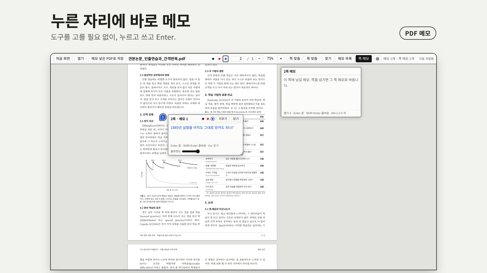

# PDF 메모

누른 자리에 바로 메모하는 무료 PDF 뷰어입니다. 윈도우 10·11과 맥에서 씁니다.

PDF를 보다가 메모하고 싶은 곳을 누르면 그 자리에 메모 창이 열리고, 쓰고 Enter를 누르면 작은 번호 핀으로 남습니다. 메모 도구를 고를 필요도, 저장 버튼을 누를 필요도 없습니다. 원본 PDF는 건드리지 않습니다.

## 내려받기

- 윈도우: [마이크로소프트 스토어에서 받기](https://apps.microsoft.com/detail/9N7TG6FP2K48?cid=github). 경고 창 없이 설치되고, 새 판이 나오면 스토어가 알아서 업데이트합니다.
- 윈도우(스토어가 막힌 PC): [압축판 받기](https://github.com/pdfmemo/pdf-memo/releases/latest/download/PDF-Memo-Windows.zip). 압축을 풀고 `PDFMemo.exe`를 열면 설치 없이 바로 켜집니다.
- 윈도우(스토어가 막힌 PC): [설치판 받기](https://github.com/pdfmemo/pdf-memo/releases/latest/download/PDF-Memo-Windows-Setup.exe)
- 맥(macOS 13.3 이상, 애플 실리콘·인텔): [맥용 받기](https://github.com/pdfmemo/pdf-memo/releases/latest/download/PDF-Memo-Mac.dmg)

판마다 바뀐 점은 [릴리스](https://github.com/pdfmemo/pdf-memo/releases)에 적어 둡니다.

## 처음 열 때

혼자 만든 무료 프로그램이라 돈을 내고 받는 서명이 없습니다. 그래서 여기서 받은 판은 처음 한 번 경고가 뜹니다. 스토어판은 경고가 없습니다.

**윈도우**

1. 파란 「Windows의 PC 보호」 창이 뜨면 「추가 정보」를 누르고 「실행」을 누릅니다.
2. 브라우저나 디펜더가 내려받기를 막으면 압축판을 받아 주세요.

**맥**

1. 받은 dmg를 열고 「PDF 메모」를 「Applications(응용 프로그램)」 폴더로 끌어다 놓습니다.
2. 처음 열면 "Apple은 'PDF 메모'에 악성 코드가 없음을 확인할 수 없습니다" 같은 알림이 뜹니다.
   - macOS 15 이상: 알림에서 「완료」를 누릅니다(「휴지통으로 이동」은 누르지 마세요). 시스템 설정 > 개인정보 보호 및 보안으로 가서 아래쪽 「보안」의 「그래도 열기」를 누르고, 암호를 넣은 뒤 한 번 더 「그래도 열기」를 누릅니다.
   - macOS 13·14: 응용 프로그램 폴더에서 「PDF 메모」를 Control 키를 누른 채 클릭하고 「열기」, 뜨는 창에서 다시 「열기」를 누릅니다.

그 뒤로는 다른 프로그램처럼 바로 열립니다.

## 새 판으로 바꿀 때

새 판을 받아 그대로 설치하거나 덮어쓰면 됩니다. 메모는 PDF와 따로 저장되어 있어서 그대로 남습니다.

- 윈도우: `C:\Users\<내 이름>\AppData\Roaming\PDF 메모`
- 맥: `~/Library/Application Support/PDF 메모`

같은 컴퓨터에서 스토어판과 설치판을 함께 쓰면 메모가 따로 저장되니 하나만 쓰세요.

## 소식 · 기능 제안

업데이트 소식은 인스타그램 [@pdfmemo3777](https://www.instagram.com/pdfmemo3777/)에 올립니다. 불편한 점이나 바라는 기능도 그쪽으로 알려 주세요.
